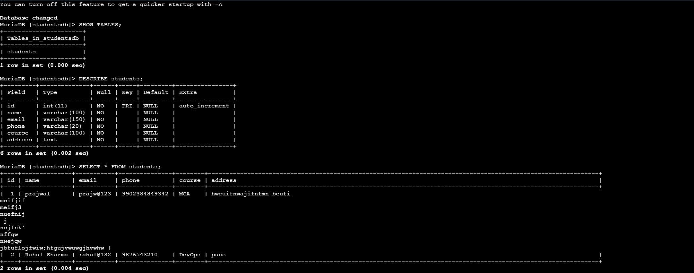
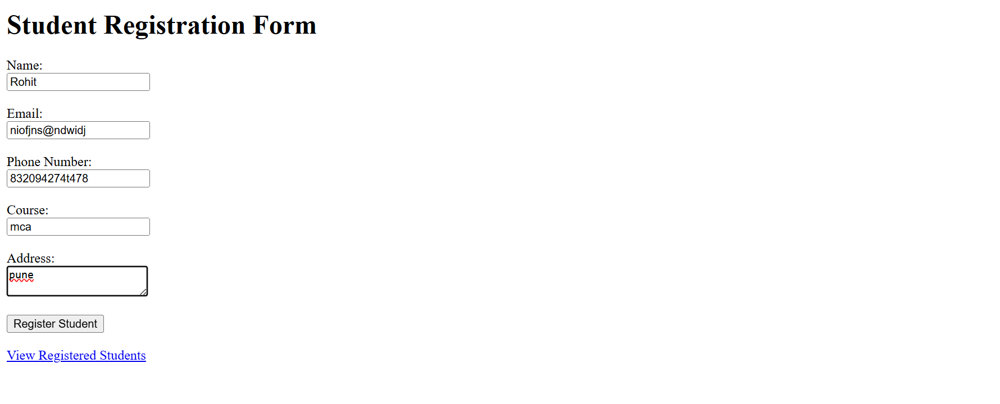
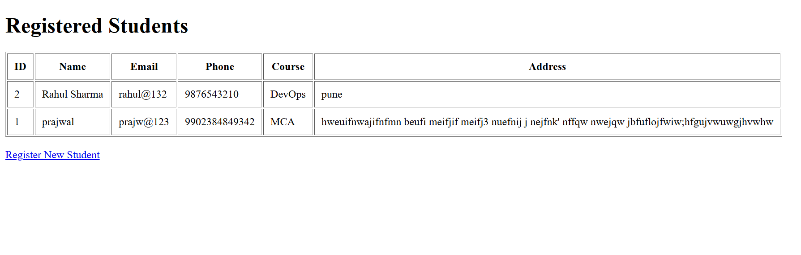
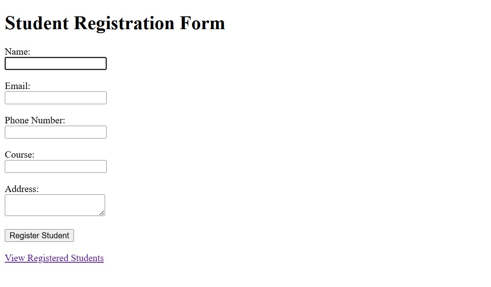
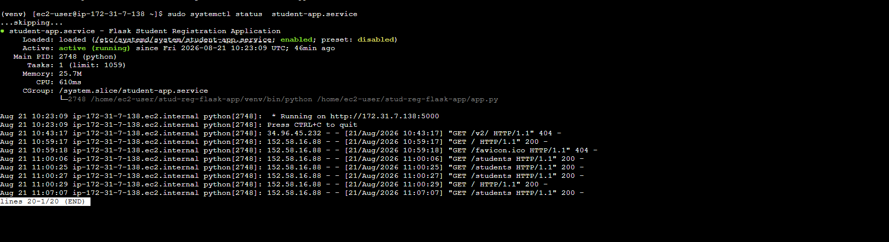

# Flask-Based Student Registration Web Application

A Flask-based Student Registration Web Application that allows users to register students through a web form, store student information in a MySQL database, and view all registered students through a web interface.

The application is deployed on an Amazon EC2 instance and uses Jenkins to automate the deployment process.

---

## 1. Project Title

**Flask-Based Student Registration Web Application Deployed Using Jenkins**

---

## 2. Project Description

This project is a simple web-based Student Registration System developed using Python Flask.

The application provides a registration form where users can enter:

- Name
- Email
- Phone Number
- Course
- Address

After submitting the form, the Flask backend validates the information and stores the student data in a MySQL database.

A separate page is provided to retrieve and display all registered students in a tabular format.

The application is deployed on an Amazon EC2 instance and Jenkins is used to automate the deployment process.

---

## 3. Project Objective

The objectives of this project are:

1. Develop a web application using Python Flask.
2. Create a student registration form.
3. Implement client-side validation.
4. Implement server-side validation.
5. Store student information in MySQL.
6. Retrieve and display registered student information.
7. Deploy the application on Amazon EC2.
8. Use Git and GitHub for version control.
9. Automate deployment using Jenkins.

---

## 4. Technologies Used

| Technology | Purpose |
|---|---|
| Python | Backend programming |
| Flask | Web framework |
| HTML | Frontend structure |
| CSS | Frontend styling |
| MySQL / MariaDB | Database |
| Git | Version control |
| GitHub | Source code hosting |
| Jenkins | CI/CD and deployment |
| Amazon EC2 | Application hosting |
| Linux | Server operating system |
| systemd | Application service management |

---

## 5. Prerequisites

The following software and services are required:

- Python 3
- pip
- Flask
- MySQL or MariaDB
- Git
- GitHub account
- Amazon EC2 instance
- Jenkins
- Internet access

---

## 6. GitHub Repository

The complete project is hosted on GitHub.

**Repository:**

https://github.com/Prajwaljolhe/Flask-Based-Student-Registration-Web-Application

---

## 7. Project Structure

```text
stud-reg-flask-app/
│
├── app.py
├── requirements.txt
├── Jenkinsfile
├── README.md
├── .gitignore
│
├── screenshots/
│   ├── 01-github-repository.png
│   ├── 02-registration-form.png
│   ├── 03-validation.png
│   ├── 04-success-message.png
│   ├── 05-mysql-record.png
│   ├── 06-students-page.png
│   ├── 07-flask-service.png
│   ├── 08-jenkins-success.png
│   └── 09-deployed-application.png
│
└── templates/
    ├── register.html
    └── students.html
```

---

## 8. Installation Steps

### Step 1: Clone the Repository

```bash
git clone https://github.com/Prajwaljolhe/Flask-Based-Student-Registration-Web-Application.git
```

Move into the project directory:

```bash
cd Flask-Based-Student-Registration-Web-Application
```

#### Deliverable

The project source code is downloaded from GitHub.

#### Screenshot


---

### Step 2: Create Python Virtual Environment

Create a virtual environment:

```bash
python3 -m venv venv
```

Activate it:

```bash
source venv/bin/activate
```

#### Deliverable

Python virtual environment is created and activated.

---

### Step 3: Install Dependencies

Install the required Python packages:

```bash
pip install -r requirements.txt
```

The main dependencies are:

```text
Flask
mysql-connector-python
python-dotenv
```

#### Deliverable

All required Python dependencies are installed successfully.

---

## 9. Database Configuration

### Step 1: Start MariaDB

On Amazon Linux:

```bash
sudo systemctl start mariadb
```

Enable MariaDB at boot:

```bash
sudo systemctl enable mariadb
```

Check the service:

```bash
sudo systemctl status mariadb
```

---

### Step 2: Login to MariaDB

```bash
sudo mysql
```

---

### Step 3: Create Database

```sql
CREATE DATABASE studentsdb;
```

If the database already exists:

```sql
USE studentsdb;
```

---

### Step 4: Create Students Table

```sql
CREATE TABLE students (
    id INT AUTO_INCREMENT PRIMARY KEY,
    name VARCHAR(100) NOT NULL,
    email VARCHAR(150) NOT NULL,
    phone VARCHAR(20) NOT NULL,
    course VARCHAR(100) NOT NULL,
    address TEXT NOT NULL
);
```

---

### Step 5: Verify Database

```sql
SHOW TABLES;
```

Verify the table structure:

```sql
DESCRIBE students;
```

Check existing records:

```sql
SELECT * FROM students;
```

#### Deliverable

The `studentsdb` database and `students` table are created successfully.

#### Screenshot



---

## 10. Environment Configuration

Database credentials should not be exposed in the GitHub repository.

Create a `.env` file:

```bash
nano .env
```

Example:

```text
DB_HOST=localhost
DB_USER=student_user
DB_PASSWORD=your_database_password
DB_NAME=studentsdb
SECRET_KEY=your_secret_key
```

The `.env` file is excluded from Git using `.gitignore`.

#### Important

Do not upload `.env` to GitHub.

---

## 11. Registration Form

The registration page is implemented using HTML.

The form contains:

- Name
- Email
- Phone Number
- Course
- Address

The form sends the submitted information to the Flask backend using the POST method.

#### Deliverable

A functional student registration form is available.

#### Screenshot



---

## 12. Client-Side Validation

HTML validation is used to prevent invalid or empty form submissions.

Examples include:

```html
required
```

and:

```html
type="email"
```

This allows the browser to perform basic validation before submitting the form.

#### Deliverable

Client-side validation is implemented.

#### Screenshot


---

## 13. Server-Side Validation

Flask validates the submitted information before inserting it into the database.

The application checks that all required fields contain data.

Example:

```python
if not name or not email or not phone or not course or not address:
    flash('All fields are required!', 'error')
```

#### Deliverable

Server-side validation prevents incomplete data from being stored.

---

## 14. Store Student Data

After successful validation, Flask connects to MySQL and inserts the student information.

Parameterized SQL queries are used:

```python
query = '''
    INSERT INTO students
    (name, email, phone, course, address)
    VALUES (%s, %s, %s, %s, %s)
'''
```

#### Deliverable

Student information is successfully stored in MySQL.

#### Screenshot


---

## 15. Success and Failure Messages

After successful registration, the application displays:

```text
Student Registered Successfully!
```

If validation fails, an error message is displayed.

If a database error occurs, an appropriate database error message is displayed.

#### Deliverable

The application provides success and failure feedback to the user.

#### Screenshot



---

## 16. Data Retrieval

The application provides a `/students` route.

Open:

```text
http://YOUR_EC2_PUBLIC_IP:5000/students
```

This page retrieves registered student records from MySQL and displays them in a table.

The table contains:

| ID | Name | Email | Phone | Course | Address |
|---|---|---|---|---|---|

#### Deliverable

Registered student information can be retrieved and displayed.

#### Screenshot


---

## 17. Run the Flask Application

Activate the virtual environment:

```bash
source venv/bin/activate
```

Start Flask:

```bash
python3 app.py
```

The application listens on:

```text
http://YOUR_EC2_PUBLIC_IP:5000
```

Student records are available at:

```text
http://YOUR_EC2_PUBLIC_IP:5000/students
```

#### Deliverable

The Flask application is running successfully on EC2.

#### Screenshot



---

## 18. EC2 Deployment

The Flask application is deployed on an Amazon EC2 instance.

The application runs on:

```text
Port: 5000
```

The EC2 Security Group should allow inbound TCP traffic on port `5000`.

Example:

```text
Type: Custom TCP
Port: 5000
Source: Your IP
```

The application can then be accessed using:

```text
http://YOUR_EC2_PUBLIC_IP:5000
```

---

## 19. systemd Service

The Flask application is configured as a Linux systemd service.

Service file:

```text
/etc/systemd/system/student-app.service
```

Start the service:

```bash
sudo systemctl start student-app
```

Enable it at boot:

```bash
sudo systemctl enable student-app
```

Restart it:

```bash
sudo systemctl restart student-app
```

Check status:

```bash
sudo systemctl status student-app
```

Expected result:

```text
Active: active (running)
```

#### Deliverable

The Flask application runs as a systemd service.

#### Screenshot



---

## 20. Jenkins Deployment

Jenkins is used to automate application deployment.

The project contains a `Jenkinsfile` in the root directory.

The Jenkins pipeline performs the following stages:

```text
Checkout
   ↓
Install Dependencies
   ↓
Validate Application
   ↓
Deploy Application
   ↓
Install Production Dependencies
   ↓
Restart Flask Application
   ↓
Verify Application
```

---

## 21. Jenkinsfile

The `Jenkinsfile` defines the CI/CD pipeline.

Main stages include:

1. Checkout source code.
2. Create Python virtual environment.
3. Install dependencies.
4. Validate `app.py`.
5. Deploy application files.
6. Restart the Flask service.
7. Verify that the application is accessible.

---

## 22. Jenkins Pipeline Configuration

Create a new Jenkins Pipeline job.

Select:

```text
Pipeline script from SCM
```

SCM:

```text
Git
```

Repository:

```text
https://github.com/Prajwaljolhe/Flask-Based-Student-Registration-Web-Application.git
```

Branch:

```text
*/main
```

Script Path:

```text
Jenkinsfile
```

Save the configuration.

Click:

```text
Build Now
```

A successful build should display:

```text
Finished: SUCCESS
```

#### Deliverable

The Jenkins pipeline successfully builds and deploys the application.

#### Screenshot


---

## 23. Testing

The following tests should be performed.

### Test 1: Registration Page

Verify that the registration form opens successfully.

Expected:

```text
Registration form is displayed.
```

---

### Test 2: Required Field Validation

Submit the form without entering required information.

Expected:

```text
Validation message is displayed.
```

---

### Test 3: Email Validation

Enter an invalid email address.

Expected:

```text
Invalid email input is rejected.
```

---

### Test 4: Successful Registration

Enter valid student details.

Expected:

```text
Student Registered Successfully!
```

---

### Test 5: Database Verification

Run:

```sql
SELECT * FROM students;
```

Expected:

```text
Registered student appears in the database.
```

---

### Test 6: Student Retrieval

Open:

```text
http://YOUR_EC2_PUBLIC_IP:5000/students
```

Expected:

```text
Registered students are displayed in a table.
```

---

### Test 7: Jenkins Deployment

Run a Jenkins build.

Expected:

```text
Finished: SUCCESS
```

---

### Test 8: Application Verification

Open:

```text
http://YOUR_EC2_PUBLIC_IP:5000
```

Expected:

```text
Student Registration Application loads successfully.
```

---
## 26. Results

The Student Registration Web Application successfully provides the following functionality:

1. Users can register students through a web form.
2. Form data is validated on the client side.
3. Form data is validated on the server side.
4. Valid student information is stored in MySQL.
5. Users receive success or failure messages.
6. Registered students can be viewed through the `/students` route.
7. The application runs on an Amazon EC2 instance.
8. The application can be managed using systemd.
9. Jenkins automates the deployment process.

---

## 27. Security Considerations

The project follows basic security practices:

- `.env` is excluded from Git.
- `venv/` is excluded from Git.
- Python cache files are excluded from Git.
- Parameterized SQL queries are used.
- Database credentials should not be committed to GitHub.
- Jenkins credentials should be stored securely using Jenkins Credentials.
- EC2 Security Group access should be restricted where possible.

---

## 28. Future Enhancements

The application can be extended with:

- Edit student records
- Delete student records
- Search functionality
- Pagination
- Bootstrap responsive design
- User authentication
- Role-based access
- HTTPS
- Nginx reverse proxy
- Automated testing
- GitHub webhook integration
- Docker deployment
- Monitoring and logging

---

## 29. Conclusion

The Flask-Based Student Registration Web Application demonstrates the complete workflow of developing, deploying, and automating a web application.

The project combines Flask, HTML, MySQL, Git, GitHub, Amazon EC2, Linux systemd, and Jenkins.

It provides practical experience in:

- Web application development
- Form handling
- Input validation
- Database integration
- Linux server management
- Git version control
- Cloud deployment
- CI/CD automation

The application successfully allows users to register students, store their information in MySQL, retrieve student records, and deploy updates through Jenkins.

---

